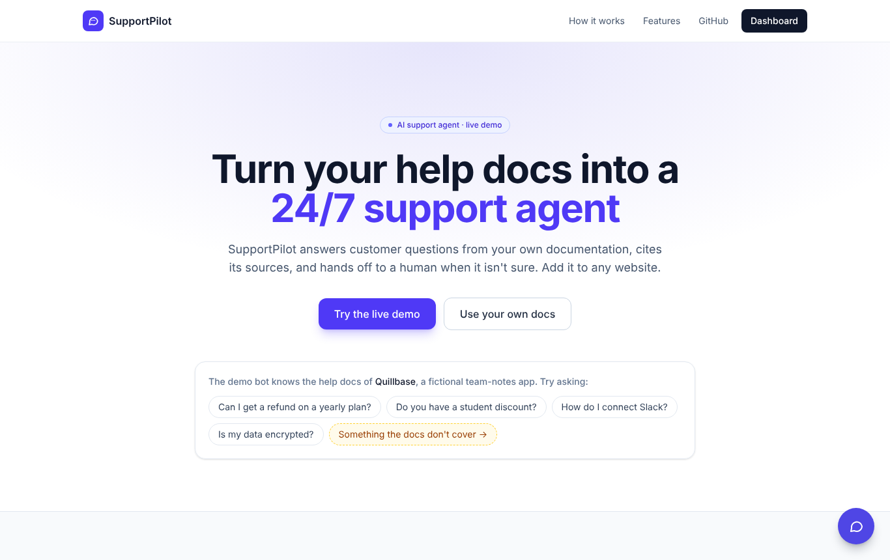
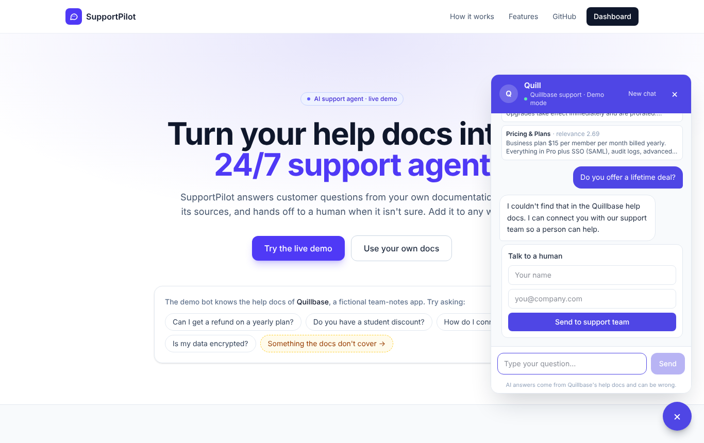
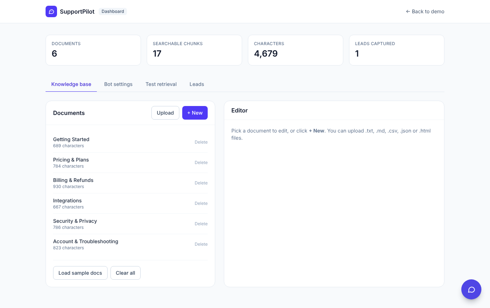
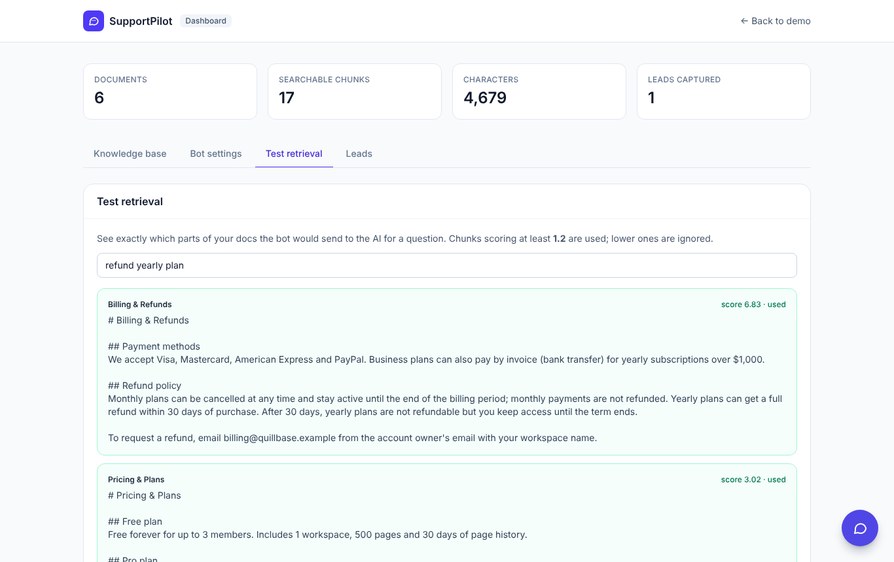
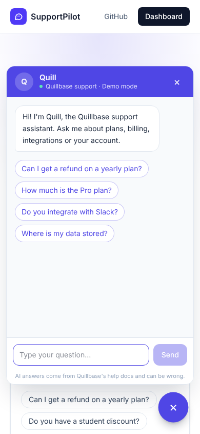

# SupportPilot: AI Customer Support Chatbot (RAG)

An AI support agent that answers customer questions **from a business's own help docs**, shows its sources, and **hands off to a human** (capturing the customer's name and email) when the docs don't have the answer.

**Live demo:** _add your Vercel link here_ · **Demo video:** _add your Loom/YouTube link here_



---

## Features

| Feature | Details |
|---|---|
| Grounded answers (RAG) | Each question is matched to the most relevant parts of the docs. Only those are sent to the AI, with strict "answer only from the docs" rules. |
| Source citations | Every answer can show which help article it came from, with a relevance score. |
| Human handoff + lead capture | When the docs don't cover a question, the bot says so and shows a "Talk to a human" form. Leads appear in the dashboard and export to CSV. |
| Claude **or** OpenAI | Switch providers with one environment variable. |
| Free demo mode | With no API key, the bot answers straight from the best-matching doc section, so the demo costs nothing to host. |
| Streaming replies | Answers type out live, with a Stop button. |
| Admin dashboard | Add, upload, edit and delete docs. Set bot name, tone, colour, welcome message and suggested questions. |
| Retrieval tester | Shows exactly which doc chunks the bot would use for any question, which helps tune a client's docs. |
| Production basics | Input validation, payload size limits, per-visitor rate limiting, safe markdown rendering (no raw HTML), mobile-friendly widget. |

| Chat with human handoff | Dashboard |
|---|---|
|  |  |

| Retrieval tester | Mobile |
|---|---|
|  |  |

---

## Tech stack

Next.js 15 (App Router) · React 19 · TypeScript · Tailwind CSS 4 · Claude API / OpenAI API (streaming over SSE) · BM25 keyword retrieval (no embeddings or vector database needed)

## How it works

```
Browser (widget + dashboard)                  Next.js server                 AI provider
──────────────────────────────                ──────────────                 ───────────
Knowledge base + settings     ── POST /api/chat ──▶  1. Split docs into sections
(stored in localStorage)                             2. Rank sections with BM25
                                                     3. Build grounded prompt ──▶ Claude / OpenAI
Streams answer + sources      ◀── text stream ────── 4. Stream reply back     ◀── (or demo mode)
```

- **Stateless server:** the knowledge base travels with each request, so the app needs no database and deploys anywhere in a few minutes.
- **Handoff:** the model is told to add a hidden `[[HANDOFF]]` marker when the docs don't have the answer. The widget strips it and shows the contact form.

## Run it locally

```bash
npm install
cp .env.example .env.local   # optional: add ANTHROPIC_API_KEY or OPENAI_API_KEY
npm run dev
```

Open http://localhost:3000 for the demo site and http://localhost:3000/dashboard for the admin panel.

## Deploy to Vercel

1. Push this repo to GitHub.
2. On vercel.com: **Add New → Project** and import the repo.
3. Optional: under **Environment Variables**, add `ANTHROPIC_API_KEY` (or `OPENAI_API_KEY`). Skip it to stay in free demo mode.
4. Click **Deploy**.

## Project structure

```
src/
  app/
    page.tsx              Landing page + live demo
    dashboard/page.tsx    Admin: docs, settings, retrieval test, leads
    api/chat/route.ts     Retrieval + AI streaming endpoint
    api/status/route.ts   Reports demo / Claude / OpenAI mode
  components/
    ChatWidget.tsx        Floating chat widget (streaming, sources, handoff)
    Markdown.tsx          Safe mini markdown renderer
  lib/
    chunk.ts              Section-aware document chunking
    search.ts             BM25 ranking + light stemming + synonyms
    llm.ts                Prompt builder + Claude/OpenAI streaming
    demo.ts               No-key demo answers
    store.ts              localStorage-backed state hooks
    sampleData.ts         Sample docs for "Quillbase" (fictional company)
```

## Roadmap (client upgrades)

- Vector embeddings (pgvector / Pinecone) for very large doc sets
- PDF and website-URL import
- Server-side storage with auth (Postgres + Prisma) for multi-tenant use
- One-line `<script>` embed for any website, plus Slack/email notifications for new leads

---
Built by **[Hamail Aslam Khan](https://github.com/hamailkhan01)**. Quillbase is a fictional company used for the demo.